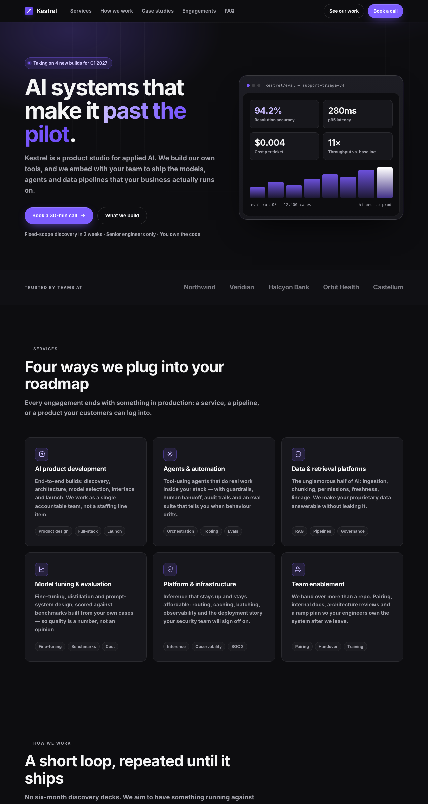
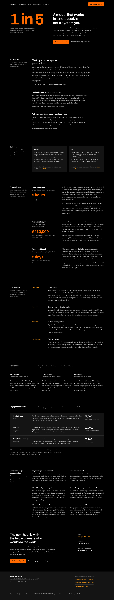

# A/B test 2: an AI development company, with a brand configuration

The category most prone to slop, run twice from the same brief. The second run
also got `unslop.palette.json` and `unslop.style.json`.

Both agents were told the brand colours in the brief. Only the second one had
them as machine-readable config.

| | baseline | unslop |
|---|---|---|
| score, default catalog | **98 / 100 — ai slop** | **0 / 100 — clean** |
| score, with the Kestrel config | **100 / 100 — ai slop** | **0 / 100 — clean** |
| render audit, 1440→390px | **18 findings** · P0 2 · P1 4 · P2 12 | **0 findings** |
| `:focus-visible` | 0 | 2 |
| `prefers-reduced-motion` | 1 | 1 |
| `unslop-ignore` used | — | 0 |
| config files edited to pass | — | 0 |

## What configuring actually did

Same page, same `--min`, with and without the config:

| | no config | Kestrel config |
|---|---|---|
| score | 98 | **100** |
| rules fired | 11 | **13** |
| `C1` purple gradient | ×2 | ×2 |
| `C4` shadow | ×2 | **×3** (`shadow.policy: "none"`) |
| `X1` colour off the declared palette | — | **×4** (`#7c5cff`, `#4a2fd0`, `#c9bcff`, `#6d4bf5`) |
| `X2` radius off the declared scale | — | **×3** (`6px`, `8px`, `999px`) |

**The score went up, not down.** Kestrel's signal is orange, so the violet the
baseline reached for was never the brand: `C1` keeps both hits, and the same
colour gets named a second time — by its hex — as drift off a declared palette.
Eight findings appeared that only exist because something was declared.

That is the honest claim for configuration: it does not make pages score
better, it makes the findings true for you. A violet brand would see the
opposite movement on `C1`, and that is the point.

## The result

- the hero leads with the figure the studio would normally hide — *one in five
  scoping weeks ends with us telling you not to build it* — and the sentence
  became its companion rather than the subject. The facts table that used to
  sit in the right-hand column is gone: the column was filled because it was
  empty, which is not a reason
- the pill badge, the gradient headline accent and the gradient button are gone;
  the brand orange stays, flat, at the declared value
- four round numbers (94.2% / 280ms / $0.004 / 11×) became a real eval table
  with per-field exact-match and p95 figures on a held-back set
- three equal icon cards became a four-row register whose first row is visibly
  the one that pays for the studio
- a left rail of mono section stamps with an orange margin mark — one idea
  reused as the wordmark's full stop, the phase marker and the focus ring
- **no icons anywhere**: no sparkles, no exhausted Lucide set, no emoji

The agent rejected its own first instinct at the anti-default gate (a centred
headline over a glowing product image). On contrast it got lucky with the
brand: `#ff6a00` measures **7.31:1** on `#000000`, so unlike a mid violet it
carries small text directly, and `#ff9f1c` (**10.21:1**) is the stop above it
for links and focus.

## Honest reading

- The scanner is not a neutral judge of the second page: the agent iterated
  against it. The independent checks are the screenshot, zero `unslop-ignore`
  comments, untouched config files, **0/100 under `--no-config` too**, and a
  render audit that reads the painted page rather than its source.
- The render audit is the check that is hard to game, because it measures
  boxes and painted colours in a headless browser, not strings in a file. The
  baseline's two P0s are both real: FAQ answers drawn on top of their own
  questions.
- Black with a bright orange accent is a recognisable combination. It is here
  because it was handed to the tool as the brand, declared in
  `unslop.palette.json` — which is exactly the case the skill treats as a
  decision rather than a default. Undeclared, the same pair would be worth a
  second look under `SD2`.
