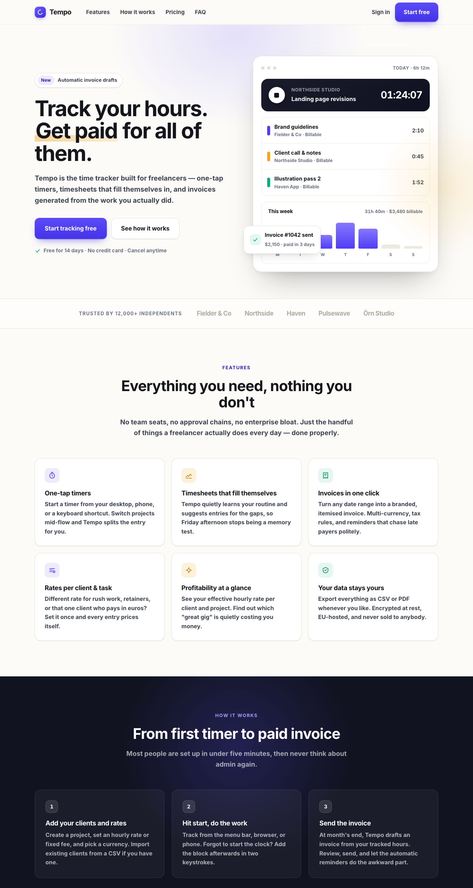
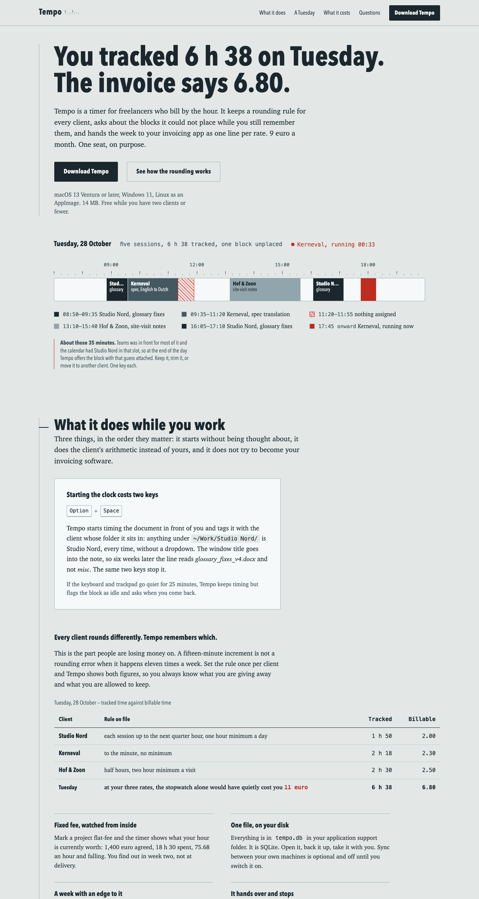

# A/B test: the same prompt, with and without the skill

Two fresh agents, no shared context, the same build brief. One was given the
brief alone. The other was told to run `SKILL.md` in `ui` mode first.

**The brief, identical for both:**

> Build a landing page. Plain HTML and CSS only, all CSS inline in one file, no
> frameworks, no build step, no JS libraries. The product is "Tempo", a
> time-tracking app for freelancers. It is a classic single-page marketing
> landing page: hero, features, how it works, testimonials, pricing, FAQ, final
> call to action, footer. Make it look good and modern.

| | baseline | unslop |
|---|---|---|
| score | **100 / 100 — ai slop** | **0 / 100 — clean** |
| rules fired | 14 | 0 |
| P0 findings | C1 ×5, L2 | none |
| `:focus-visible` | 0 | 5 |
| `prefers-reduced-motion` | 0 | 1 |
| ground | `hsl(45 40% 98%)` | `hsl(172 9% 90%)` |
| signal | `hsl(246 90% 60%)` (indigo) | `hsl(5 72% 43%)` (index red) |
| silenced with `unslop-ignore` | — | 0 |

## What the baseline produced unprompted

`C1` ×5 indigo gradients · `C2` `--accent: #4f3df5` · `C4` ×5 coloured glow
shadows · `L2` three icon-topped feature cards · `T3` ×5 tracked all-caps
eyebrows · `T4` an accented word in the headline (`<em>Get paid</em>`) ·
`S4` ×3 glassmorphism · `S1` uniform radius + shadow · `L5` seven stock sections
in the canonical order · `P5` "Get started" · `K3` no focus styles · `M2` no
reduced-motion.

**The interesting part:** it fired the violet rules *and* both post-violet
second-order defaults at once — `SD2` (near-black band + acid accent `#13a981`)
and `SD3` (emerald as the not-purple accent). The model already knows the
tasteful escape route from purple, and applies it alongside the purple. That is
the case for cataloguing the SD tier at all.

## What the skill changed

Not the palette — the derivation. The second agent's direction came from the
subject's material world (punch clocks, metronome dials, stopwatch faces,
timesheet grids), which produced: an instrument-enamel ground, one red index
mark with a single job (*time at risk*), tabular figures, a quarter-hour tick
scale used only where time is actually measured, and a vertical timesheet spine
the whole page hangs off.

It also rejected its own first derivation at the anti-default gate — manila
paper, blue rule lines, red overtime column — on the grounds that paper-and-ink
is what it would reach for with a notes app or an invoicing tool too, and lands
adjacent to `SD1`/`SD6`. That rejection is the skill working as designed.

Content followed: the hero cites a specific Tuesday, and the data table two
screens down sums that same Tuesday's 6 h 38 tracked into 6.80 billable under
three different per-client rounding rules. The headline claim is evidenced
later in the page rather than asserted.

## Honest reading of this result

- **The scanner is not a neutral judge of the second page.** The agent iterated
  against it until it was clean, so 0/100 partly measures compliance. The
  independent evidence is the screenshot, the absence of `unslop-ignore`
  comments, and the accessibility numbers, which are checkable facts.
- **The two pages are not equally good at the same job.** The unslop version is
  denser and more editorial, closer to documentation than to conversion-first
  marketing. For a product sold on specifics that is a feature. For an impulse
  purchase it may not be. The skill makes a page distinctive; it does not make
  it convert.
- **One pass is one data point.** Run it on your own brief before believing it.
