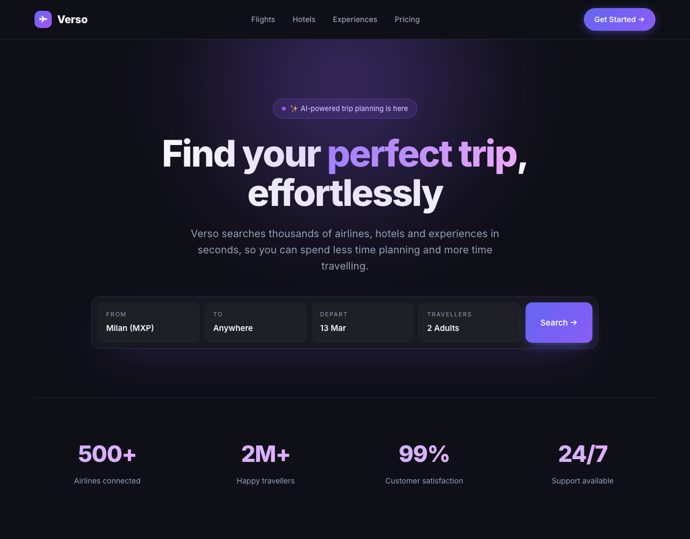
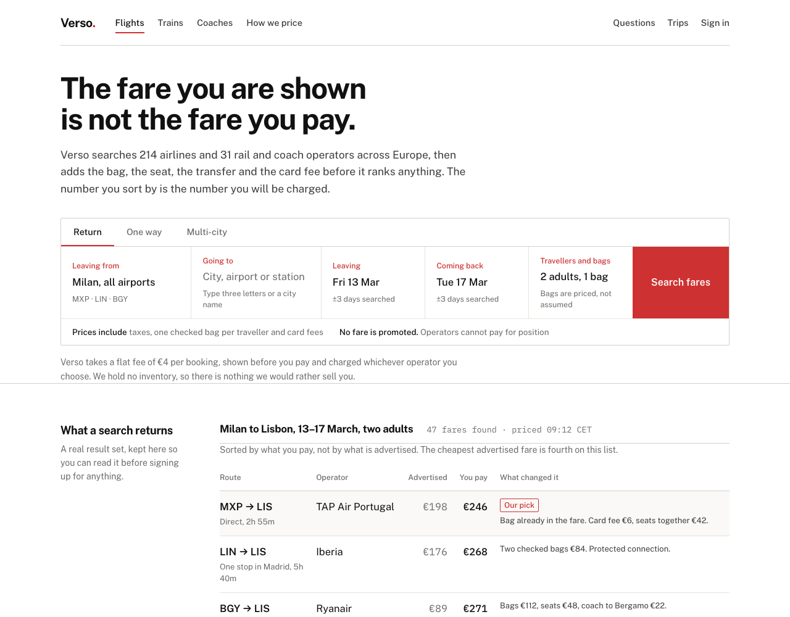

# A third brand: a travel search, from a screenshot

The palette was not chosen here. It was read off a screenshot of an existing
travel site, sampled in a headless browser rather than eyeballed:

| Role | Value | Where it came from |
|---|---|---|
| `signal` | `#ce3131` | the Search button, sampled twice in solid areas (`#ce3131`, `#cf3030`) |
| `ground` | `#ffffff` | the page and the search bar are both pure white |
| `ink` | `#111111` | the darkest pixel inside a heading is `#010101` |
| `rule` | `#d4d0ca` | the warm grey at the edge of the search bar |

**One value was not copied.** The reference's secondary grey measures
`#acacac`, which is **2.27:1** on white and fails AA. It moved down the same
neutral ramp to `#6b6b6b`, 5.0:1. Copying a brand does not mean copying its
accessibility faults.

`#ce3131` measures **5.11:1** on white, so it carries small text *and* takes
white text on top at the same ratio — which is why the field labels and the
Search button can both be red without a second accent.

## The direction

The category default is a photograph of a sunset with a search form shrunk
onto it, then a row of destination cards with *from &euro;49*. Verso does the
opposite of the one thing that matters: **the search is the hero at full
width**, and the page's evidence is a real result set shown before you are
asked for anything — including the row that proves the cheapest advertised
fare costs &euro;218 more than it says.

The hero is deliberately **not** the figure-led shape used for the previous
brand in `examples/ab-test-ai`. Repeating your own last direction is the thing
rule `SD0` exists to catch, and the skill is not exempt from it.

## Gates

| | result |
|---|---|
| source scanner, with config | **0 / 100 — clean** |
| source scanner, `--no-config` | **0 / 100 — clean** |
| render audit, 1440 &rarr; 320px | **0 findings** |
| `unslop-ignore` used | 0 |
| `<script>` tags | 0 |

## What the audit caught, and what it did not

The render audit found five real faults on the first pass: a footer row whose
trailing links finished 92px apart, a five-column fare table running off a
320px screen, form fields 23.9px tall against a 24px hit floor, and a tag one
pixel under the legible floor. All were fixed in the page.

Two faults it did **not** catch were found by looking:

- the right-aligned money columns had no padding on the side they align to, so
  `&euro;246` sat against the next column's first word. Nothing overlapped, so
  every check stayed quiet.
- at 390px the table's `<caption>` was left as `table-caption` inside a table
  that had become `display: block`, which crushed it to a 12px column and
  broke the sentence **one letter per line**.

The second one became a new check, `text_squeezed` (P0), with a test. The
first is still a job for eyes.
